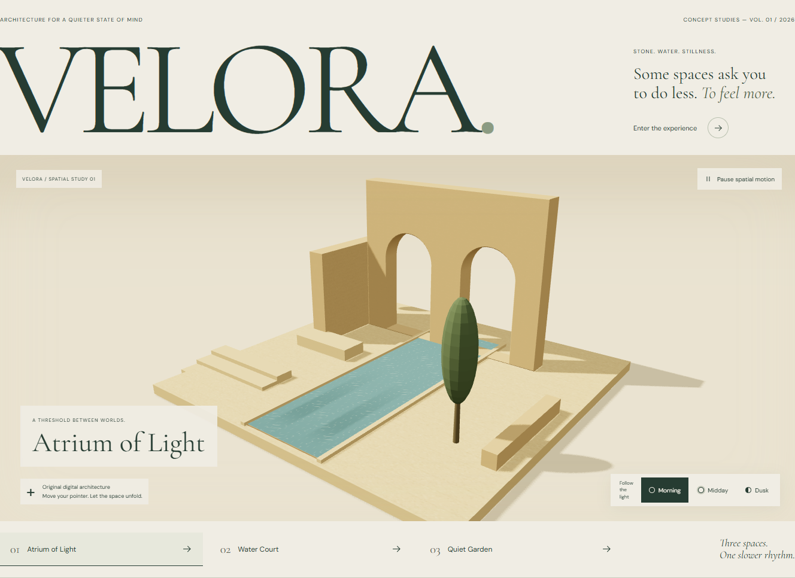

# VELORA — Spaces to slow down

[Explore the concept](https://seoshiro.github.io/velora-atelier/) · [Release checks](https://github.com/seoshiro/velora-atelier/actions)

An original, fictional architecture atelier: warm stone, still water and a quieter rhythm. A compact editorial portfolio with monumental typography, original architectural studies and an interactive spatial scene.



[Desktop screenshot](qa/screenshots/local-desktop.png) · [Mobile screenshot](qa/screenshots/local-mobile.png) · [320 px screenshot](qa/screenshots/local-narrow-320.png)

**Fictional concept.** VELORA is not a physical property, architectural practice, booking service or commercial offering. Areas, names and studies describe imagined spaces. There are no payments, reservations, reviews, certifications or sign-up forms.

## Explore

- Three original spaces: Atrium of Light, Water Court and Quiet Garden.
- Morning, Midday and Dusk lighting; nine shareable query states with Back/Forward and reload support.
- Pointer and scroll parallax, a pause control, system reduced-motion support, and a complete original SVG fallback when WebGL or the optional scene module is unavailable.
- Download a real, locally generated SVG design card reflecting the selected space and light. No server or sign-up.
- Keyboard, touch and narrow-screen layouts; content and controls remain outside the canvas.

## Run locally

Node 24 and npm. Install with `npm ci`, then `npm run dev`. This isolated project uses port **4317**, base path `/velora-atelier/`, and a single Playwright worker.

```sh
npm run typecheck
npm run lint
npm run test:unit
npm run build
npm run test:e2e
```

Playwright uses the existing Chromium installation on the development Windows machine and the preinstalled Google Chrome on the pinned Ubuntu 24.04 GitHub runner. CI does not download apt dependencies. All Actions are pinned to verified official release SHAs. The complete long CI story has a 120 s total budget, with 15 s action and 30 s navigation limits; local stories retain 45 s. For another machine, install the matching Playwright browser or configure an installed compatible browser.

To run the complete browser suite against a public deployment, set `BASE_URL=https://seoshiro.github.io/velora-atelier/` and run `npm run test:e2e`. Production build embeds its exact source commit in `release.json`; `node scripts/verify-release.mjs <url>` compares the deployed SHA and every asset's SHA-256 against the local build.

## Evidence and independent roles

Five real agent roles worked in isolated ownership areas: integrator/publication, architectural art and motion, interaction logic, independent visual/browser QA, independent code/performance/security QA. The two reviewers reported defects for the integrator to fix and reverify.

- [Browser/visual report](qa/VISUAL-QA.md)
- [Code, performance and security report](qa/CODE-QA.md)
- [Dependency audit](qa/dependency-audit.json)
- [Deterministic UI review](qa/21st-ui-review.json)
- [Browser tests](tests/experience.spec.ts) and [logic tests](src/model.test.ts)
- [Screenshots](qa/screenshots/)
- GitHub Actions keeps separate local and production browser evidence artifacts on every release.

Local release gates passed: TypeScript (including tests and configs), ESLint, production build, 6 logic tests and 8 browser stories. Four viewport axe scans reported zero WCAG 2/2.1 A/AA violations. Nine motion-paused architectural renders produced nine distinct pixel hashes. Actual browser screenshots were inspected independently.

Controlled local observations: Chromium 156 headless on Windows, 1440 x 1000, DPR 1, CPU throttled 4x, unthrottled network, three fresh contexts. Median FCP/LCP (the heading) 1.076 s; median WebGL ready 1.834 s; observed CLS 0.00652. Rendering lifecycle checks observed zero RAF callbacks while paused, offscreen and under system reduced motion. These measurements include scene initialization long tasks and are not field INP measurements.

Applied instruction skills: ECC-derived Windows engineering, 21st UI Build/Review, React best-practices review and full-story verification. ECC here is an instruction-only adaptation: no ECC runtime, hooks or background collection were installed. This new empty checkout had no existing `.agents/skills` directory. The 21st free catalog search failed; no metered code or AI generation was used. The free CLI deterministic review ran and reported zero errors/warnings; palette literals in original artwork are informational suggestions.

## Assets and limits

All architecture, textures, illustrations and postcards are original. Fonts are self-hosted Cormorant Garamond and DM Sans under OFL. [Asset provenance and licenses](ASSET-LICENSES.md). Code: MIT; original artwork: CC BY 4.0.

The WebGL scene is a stylized architectural study, not a physically accurate building simulation. It caps DPR at 1.5 and draws at most 30 fps while visible; it pauses offscreen and when hidden. Performance figures are controlled lab observations, not field Core Web Vitals or guarantees on every GPU. Automated axe checks supplement manual keyboard and visual inspection; they do not establish full accessibility certification. Browser engine coverage and remaining limits are recorded in the QA reports.

No analytics, external runtime APIs, accounts, storage persistence, keys, cookies, payments or paid services. Static publication uses free public GitHub Pages and Actions. To roll back, revert the release commit and rerun the workflow, or redeploy a previously verified commit.
